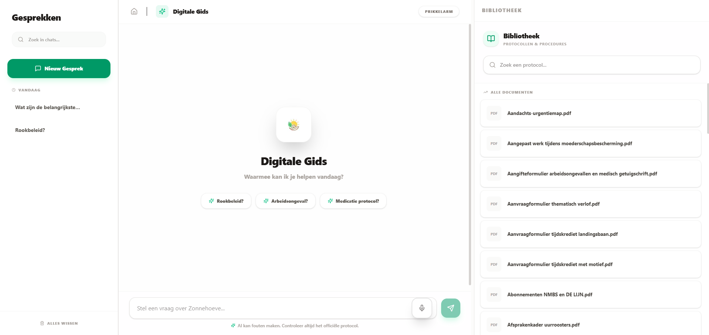

# Zonnehoeve Enterprise

[](https://github.com/KynanM/zonnehoeve-entreprise/actions/workflows/ci.yml)



Knowledge platform for care staff at Zonnehoeve Living+. Staff ask questions in Dutch. The app retrieves passages from internal PDF and DOCX protocols and asks a language model to answer from those passages, with a link back to the source page.

## Context

Built for Zonnehoeve Living+ in Nazareth-Eke as a project at VIVES University of Applied Sciences, Kortrijk, by Kynan Melsens and Aaron Vangermeersch. The platform is being handed over to the organisation for use.

## Stack

- Frontend: Next.js 16, React 19, TypeScript, Tailwind CSS 4, Framer Motion, Lucide
- Backend: FastAPI on Python 3.11, LangChain
- Data: PostgreSQL with pgvector, OpenAI embeddings (`text-embedding-3-small` by default) and chat (`gpt-4o-mini` by default)
- Retrieval: pgvector similarity search combined with BM25. FlashRank runs only when `USE_RERANKER=true` (default `false`)
- Deploy: Docker Compose and Railway
- Tests: pytest, Jest, and a Playwright spec (`frontend/tests/e2e/chat.spec.ts`). GitHub Actions runs pytest and Jest

## How answers stay grounded

Protocol questions go through retrieval before the model answers.

1. The system prompt in `backend/api/prompts.py` tells the model to use the retrieved context. If the answer is not in that context or the chat history, it must reply only: "Ik kan hier helaas geen informatie over vinden in de huidige protocollen."
2. `backend/api/rag.py` loads a vector retriever (`RETRIEVER_K`, default 4). It also builds a BM25 retriever over chunks pulled from the vector store and combines the two with an ensemble (weights 0.4 BM25, 0.6 vector). If the BM25 load fails, retrieval falls back to vectors only.
3. FlashRank is optional. It is off unless `USE_RERANKER=true`.
4. Greetings and thanks that match a fixed word list skip retrieval and get a short reply without sources (`backend/services/chat_service.py`).

Source links open the stored file. The chat stream sends `__sources__:` entries shaped as `filename#page=N`, taken from each retrieved chunk. A citation button calls `handleDocumentClick`, which selects that file and page. The UI fetches `/api/documents/{filename}` and shows the PDF in an iframe with the `#page=` fragment.

What the tests cover:

- `backend/tests/test_chatbot_qa_expert.py` checks prompt-leakage phrases, a few jailbreak phrases, refusal on questions outside the protocols, recall of a name and department across a 10-turn history, time to first token under 1.5 seconds, and a mocked database error during chat. Unless `USE_REAL_RAG=true` and a real OpenAI key are set, these tests use a mock chain rather than a live model. Results are written to `backend/data/safety_test_results.json` for the admin safety tab.
- Each chat request stores `latency_seconds` on the chat log. The admin dashboard shows the average and the per-log time.

## Getting started

Requirements: Node.js 20, Python 3.11, Docker, and an OpenAI API key.

```bash
git clone https://github.com/KynanM/zonnehoeve-entreprise.git
cd zonnehoeve-entreprise
```

Backend:

```bash
cd backend
python -m venv venv
venv\Scripts\activate
pip install -r requirements.txt
```

Frontend:

```bash
cd frontend
npm ci
```

Copy `.env.example` to `.env` and set `OPENAI_API_KEY` and `ADMIN_API_KEY`. Do not commit `.env`.

Docker Compose starts Postgres (pgvector) on host port 5433 with user `postgres`, password `postgres`, and database `zonnehoeve`, plus the backend and frontend:

```bash
docker-compose up -d
```

Without Compose, from `backend` run `uvicorn main:app --reload`, and from `frontend` run `npm run dev`. Point `DATABASE_URL` at a Postgres instance with pgvector. The example file uses port 5432; the Compose database is published on 5433.

| Variable | Role |
| :--- | :--- |
| `DATABASE_URL` | Async SQLAlchemy URL (`postgresql+asyncpg://...`) |
| `OPENAI_API_KEY` | Chat and embeddings |
| `ADMIN_API_KEY` | Admin API and the admin WebSocket |
| `CORS_ORIGINS` | Allowed browser origins |
| `LLM_MODEL` | Chat model, default `gpt-4o-mini` |
| `EMBEDDING_MODEL` | Embedding model, default `text-embedding-3-small` |
| `USE_RERANKER` | `true` enables FlashRank |
| `BACKEND_URL` | Backend URL used by the Next.js server |
| `NEXT_PUBLIC_API_URL` | Backend URL used by the browser, including the admin WebSocket |

API docs: [http://localhost:8000/docs](http://localhost:8000/docs) and [http://localhost:8000/redoc](http://localhost:8000/redoc).

Admin routes under `/api/admin` and document upload expect the `X-Admin-Key` header. The WebSocket at `/ws/admin` expects a `token` query parameter. Both are checked against `ADMIN_API_KEY`. The frontend does not ship that key.

## Project structure

```text
zonnehoeve-entreprise/
├── backend/
│   ├── api/                 # HTTP and WebSocket routes
│   ├── services/            # Chat, ingestion, stats
│   ├── scripts/             # Database and ingest commands
│   ├── tests/
│   ├── models.py
│   └── main.py
├── frontend/
│   ├── src/app/
│   ├── src/components/
│   ├── src/lib/
│   └── tests/               # Playwright spec
├── scripts/
│   └── upload_to_railway.py
├── docs/images/
├── docker-compose.yml
└── railway.json
```

## Scripts

Frontend: `npm run dev`, `npm run build`, `npm run start`, `npm run lint`, `npm test`.

From `backend`:

- `pytest`
- `uvicorn main:app --reload`
- `python -m scripts.ingest` indexes files in `backend/data/raw_documents`
- `python -m scripts.init_db` creates tables and enables the `vector` extension
- `python -m scripts.optimize_db` adds query indexes, converts `retrieved_sources` to JSONB, and sets `ON DELETE CASCADE` on chat logs
- `python -m scripts.migrate_metadata` adds `outline` and `summary` on `document_metadata` if they are missing
- `python -m scripts.migrate_user_id` adds `user_id` on `chat_threads` if it is missing
- `python -m scripts.inspect_db` prints columns and indexes

From the repository root, `python scripts/upload_to_railway.py` uploads local PDF and DOCX files. Set `RAILWAY_URL` and `ADMIN_API_KEY` first.

The admin QA tab reads generated files and shows "Nog geen rapport" until they exist. From `backend`:

- `pytest --json-report --json-report-file=pytest_results.json`
- `pytest --cov=. --cov-report=xml`
- `ruff check . --output-format=json > ruff_report.json`
- `pytest tests/test_chatbot_qa_expert.py` writes `data/safety_test_results.json`

GitHub Actions writes the same reports and uploads them as the `qa-reports` artifact. They are not stored in git.

## Licence

Proprietary. Copyright © 2026 Kynan Melsens & Aaron Vangermeersch. Zonnehoeve Living+ receives a licence for internal use and modification. See [LICENSE](LICENSE).
